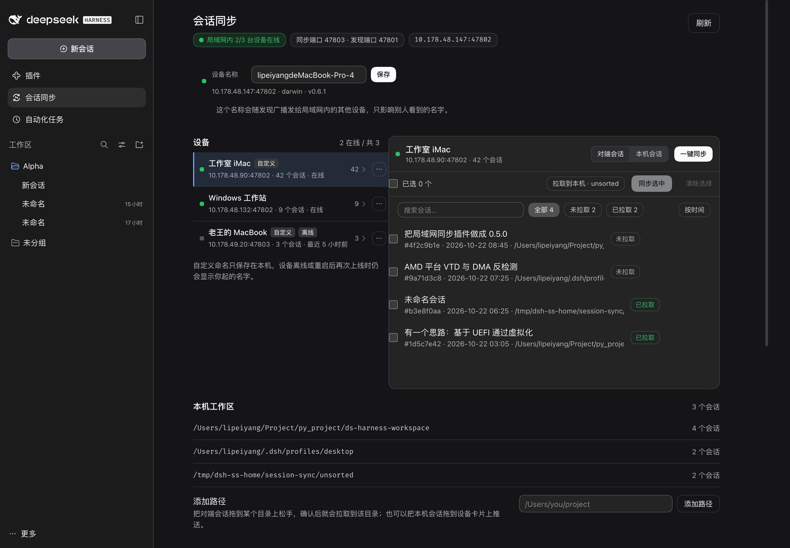
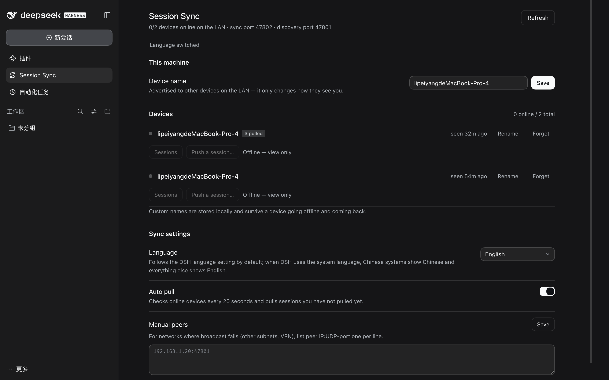

# dsh-session-sync

**LAN session sync for DSH.** Every DSH that has this plugin discovers the others on the local network, lists their sessions, and can pull or push conversations over plain HTTP. The nickname you give a device lives **only on your machine** — the peer can go offline, reboot, or change IP and come back, and you still see the name you gave it.

<div align="center">

[](https://github.com/XXGxiaoyu/dsh-session-sync/actions/workflows/ci.yml)
[](https://github.com/XXGxiaoyu/dsh-session-sync/stargazers)
[](https://opensource.org/licenses/MIT)
[](https://www.npmjs.com/package/@deepseek-ai/dsh)

🌏 [简体中文](./README_ZH.md) · **English**

</div>



## ✨ Features

| | |
|---|---|
| **📡 Zero-config discovery**<br/>UDP broadcast on every IPv4 interface with a 4s beacon. A peer that just appeared gets an immediate unicast reply, so new devices show up without waiting for the next round. | **🏷️ Local-only nicknames**<br/>Stored in `<home>/session-sync/state.json` and keyed by a stable **device id** (uuid) — not IP, not hostname. The peer renaming itself never overwrites your label. |
| **🗂️ Browse · pull · push**<br/>See each device's sessions with title, cwd and time; pull one into this machine or push one of yours out. Imported rows are marked as pulled. | **🔐 SHA-256 verification**<br/>Exports carry `sha256 = SHA-256(JSON.stringify({format, session, events}))`; imports compare it **before writing a byte** and refuse with HTTP 409 `checksum-mismatch`. Each row has a *Verify* action. |
| **🔁 Optional auto-pull**<br/>Every 20s, pull sessions you have not pulled yet. Content fingerprints (not ids) stop two machines with auto-pull on from bouncing one conversation back and forth forever. | **🎨 Native look, i18n**<br/>Built from DSH design tokens (colors, radii, type scale, 0.2s transitions), so light/dark follow the host. Language follows DSH by default, with explicit 中文 / English overrides. |
| **🖱️ Drag, select, drop**<br/>Select one or many sessions and drag them onto any known folder — every drop asks for confirmation and names the folder the conversation will be imported into. | **🚦 Confirmed transfer queue**<br/>Repeated pushes/pulls are detected up front; a dialog lets you keep the local copy, overwrite it, or drop that single item. The rest of the queue keeps running in order. |
| **⚡ One-click sync**<br/>**Sync all** / **Push all** plan the whole device in one go, skip sessions already present by content fingerprint, and report each row as done, skipped or failed. | **🌐 Cross-subnet scanning**<br/>Broadcast stays on the local segment; add CIDRs, IPs or `ip:port` under *Cross-subnet scan*. CIDRs get silent UDP discovery packets, single IPs are also probed over HTTP on 47802–47817 — a firewall that drops UDP no longer hides the peer. |

## 🚀 Installation

```sh
dsh plugin --profile web add github:XXGxiaoyu/dsh-session-sync
```

Requires DSH **0.2.1-rc.2** (the version bundled with the current desktop app) and Node 22+.

Then restart the DSH desktop app (host-side changes load at boot; open pages pick up the new UI on refresh). The install is auto-activated: the package declares `dsh.bundle`, so `dsh plugin add` adds it to `dsh.profile.bundles` on its own.

Prebuilt tarball (no build step): <https://github.com/XXGxiaoyu/dsh-session-sync/releases/latest/download/dsh-session-sync.tgz>

<details>
<summary>Manual install from a local checkout</summary>

```jsonc
// ~/.dsh/profiles/<profile>/package.json
{
  "dependencies": {
    "dsh-session-sync": "link:/absolute/path/to/dsh-session-sync"
  },
  "dsh": {
    "profile": {
      "bundles": ["@deepseek-ai/dsh-base", "@deepseek-ai/dsh-web-app", "dsh-session-sync"]
    }
  }
}
```

```sh
cd ~/.dsh/profiles/<profile> && pnpm install
```

</details>

Confirm it loaded — the log shows:

```text
[dsh-session-sync] ready: device <hostname>, sync port 47802, discovery port 47801
[dsh-session-sync] discovered <peer name> (192.168.1.7:47802)
```

## 🧭 Where it lives

A **Session Sync** row appears under **Plugins** in the left sidebar (`sidebar.panellist` + keyed `main` panel, id `session-sync`). The same component is also registered as **Settings → Session Sync** (`settings.section`).

- **This machine** — the name other devices see; changing it broadcasts immediately.
- **Devices** — online/offline, last heartbeat, session count, platform and version.
- **Rename / Forget** — a per-device nickname for this machine only. Offline devices keep their row (and their nickname), greyed out.
- **Sessions / Pull / Push** — list a peer's sessions, copy one here, or send one over.
- **Verify** — re-fetch the peer's payload, recompute SHA-256 and compare it with the local copy (`sha256 2b12f7854d80… verified`).
- **Sync settings** — UI language, auto-pull, and manual peer addresses for networks where broadcast is blocked (`ip` or `ip:udpPort`, one per line).

## 🌏 UI language

| Option | Behavior |
| --- | --- |
| Follow DSH (default) | Use DSH's current language. DSH already resolves the system language, so non-Chinese systems get English, Chinese systems get Chinese |
| 中文 | Always Chinese |
| English | Always English |

```text
settings.locale = 'auto' | 'zh' | 'en'   // persisted in <home>/session-sync/state.json
```

The plugin reads `ctx.locale.getSnapshot().active` (`zh*` → Chinese, everything else → English) and only falls back to `navigator.languages` when no locale service exists. A language change is written to disk **before** the UI switches, so it never reverts on the next open. Sidebar/settings labels are resolved by the host, so the plugin re-registers its slots when the language changes — the page and the sidebar row never disagree.



## 🎨 Look and motion

The UI uses DSH's own CSS variables rather than copied hex values: `--dsw-alias-*` for colors, `--dsw-radius-*`, the `--dsw-font-*` scale, and `var(--ds-transition-duration) var(--ds-ease-in-out)` for every transition. Layout follows the built-in settings pages — title + muted note on the left, control on the right, `.5px` dividers, 32px inputs/selects, 36×22 pill switches — so it stays consistent in both themes and in narrow windows.

## ⚙️ Configuration (loader row `config`)

| Key | Default | Meaning |
| --- | --- | --- |
| `name` | hostname | Initial display name (the GUI value wins afterwards) |
| `lanPort` | `47802` | Sync HTTP port; tries the next 16 ports when busy |
| `discoveryPort` | `47801` | UDP discovery port |
| `token` | none | If set, LAN HTTP calls must send `x-dsh-session-sync-token` |
| `home` | `$DSH_HOME` or `~/.dsh` | Root for state and sessions |
| `autoPullIntervalMs` | `20000` | Auto-pull interval (lowered in tests) |
| `verbose` | `true` | Turn plugin logging off |
| `subnets` | `[]` | Extra CIDRs/IPs/`ip:port` for devices that UDP broadcast cannot reach (e.g. `192.168.5.0/24`, `10.0.0.7`, `10.0.0.7:47802`). CIDRs use UDP discovery packets; bare IPs are also probed over HTTP on 47802–47817 |

## 🔌 LAN protocol (`/v1/*`)

Binds `0.0.0.0`; every route except `/v1/health` requires `x-dsh-session-sync: 1`.

| Method | Path | Purpose |
| --- | --- | --- |
| GET | `/v1/health` | `{ok:true}` liveness |
| GET | `/v1/info` | Device id, name, session count, version |
| GET | `/v1/sessions?limit=N` | Session summaries |
| GET | `/v1/sessions/:id` | Export `{format:'dsh-session-sync/1', session, events, sha256}` |
| POST | `/v1/sessions` | Import the same payload (verified when `sha256` is present), returns the new id; `?force=1` skips the receiver-side fingerprint check |

Discovery is a UDP broadcast: every 4s a `dsh-session-sync/hello` datagram (`{id, name, port, platform, version, sessions}`) goes to each IPv4 interface's broadcast address, `127.0.0.1`, and any configured seeds; unknown ids are answered by unicast right away.

The GUI side (`/session-sync/api`) runs on DSH's own loopback web server and is fenced by the host connection policy; `/v1/*` is the only surface exposed to the LAN.

## 🧵 Design notes

- **Nicknames are keyed by device id, not IP.** `deviceId` is a uuid generated on first start; `peers[<deviceId>].customName` is yours alone.
- **Imports use the official persistence service** — `ctx.sessionPersistence.create() → append() → flush()`, with a v4 header that keeps only the allowed keys (`version/id/createdAt/cwd/isSeeded/delegationDepth/parentSession/agentPreset`). One extra `type` is rejected with `format v4 header has unexpected field type`.
- **Imports keep the source `createdAt`, re-index ids and seq.** The id must be unique per machine; seq starts at 0 and stays contiguous; `createdAt` is preserved so content fingerprints agree.
- **Cross-machine `cwd`.** The source cwd is kept when it exists here, otherwise it falls back to `process.cwd()` — a session pointing at a path that does not exist would vanish from the workspace list.
- **SHA-256 is byte-exact.** Exports and imports serialize the same object, so key order is identical and digests are comparable. Mismatch aborts before persistence.
- **Fingerprints, not ids, dedupe auto-pull.** `state.signatures[sha1(createdAt, event shape, first preview)]` is recorded on export and import; auto-pull skips anything already known. Without it, two auto-pulling machines would keep re-importing the same conversation under new ids.
- **Everything local stays local.** Nicknames, import records and settings never leave `<home>/session-sync/state.json`.

## 🧪 Development

```bash
node --test --test-force-exit --test-timeout=120000 'test/*.test.mjs'
```

30 cases: client bundle contract, dictionary parity, footer and language resolution (11), jsdom mount and interactions (4), two-instance end-to-end — discovery, rename persistence, restart, pull/push, auto-pull dedupe, receiver dedupe, SHA-256 tamper rejection and HTTP-only discovery (8), and the probe fallback contract (7).

Run a headless instance without the desktop shell:

```bash
DSH_HOME=/tmp/dsh-ss-home node <dsh>/lib/bin.js --profile ssync --no-open --host 127.0.0.1 --port 4399
```

`--profile` must come **before** launcher flags such as `--no-open`; `web --profile x` fails with `select a profile only once`.

## 📄 License

[MIT](./LICENSE)
